# Poly Haven: Metal textures

**26 assets from [Poly Haven](https://polyhaven.com), dedicated to the public domain under [CC0](https://polyhaven.com/license).** Use them in any game, free or paid, and change them however you like; no credit is needed.

PBR textures as 1K and 2K JPG maps (colour, normal (GL and DX), roughness, AO, displacement and more). 488.2 MB in all.

This is a copy kept by [zuujis-cc0](https://github.com/zuujis-cc0) so game makers can take single files from GitHub. It is not made by or affiliated with Poly Haven: the originals, often in more formats and higher resolutions, are on [polyhaven.com](https://polyhaven.com). If they help you, consider [supporting Poly Haven](https://www.patreon.com/polyhaven/overview).

Every file is listed in [MANIFEST.tsv](MANIFEST.tsv) with its size and SHA-256. More free assets: [the Zuujis collection](https://github.com/zuujis-cc0/free-game-assets#readme).

| | | | |
| :-: | :-: | :-: | :-: |
| <a href="blue_metal_plate">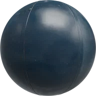</a> <b><a href="blue_metal_plate">Blue Metal Plate</a></b> by Rob Tuytel · <a href="https://polyhaven.com/a/blue_metal_plate">source</a> | <a href="box_profile_metal_sheet">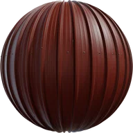</a> <b><a href="box_profile_metal_sheet">Box Profile Metal Sheet</a></b> by Amal Kumar · <a href="https://polyhaven.com/a/box_profile_metal_sheet">source</a> | <a href="container_side">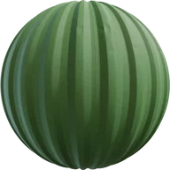</a> <b><a href="container_side">Container Side</a></b> by Dimitrios Savva · <a href="https://polyhaven.com/a/container_side">source</a> | <a href="corrugated_iron">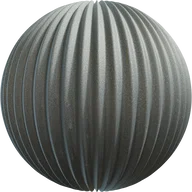</a> <b><a href="corrugated_iron">Corrugated Iron</a></b> by Dimitrios Savva, Jenelle van Heerden · <a href="https://polyhaven.com/a/corrugated_iron">source</a> |
| <a href="corrugated_iron_02">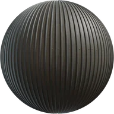</a> <b><a href="corrugated_iron_02">Corrugated Iron 02</a></b> by Jenelle van Heerden, Sergej Majboroda · <a href="https://polyhaven.com/a/corrugated_iron_02">source</a> | <a href="corrugated_iron_03">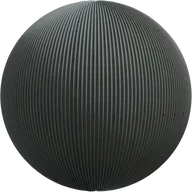</a> <b><a href="corrugated_iron_03">Corrugated Iron 03</a></b> by Charlotte Baglioni · <a href="https://polyhaven.com/a/corrugated_iron_03">source</a> | <a href="factory_wall">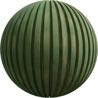</a> <b><a href="factory_wall">Factory Wall</a></b> by Rob Tuytel · <a href="https://polyhaven.com/a/factory_wall">source</a> | <a href="green_metal_rust">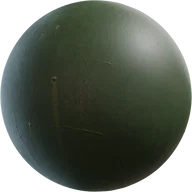</a> <b><a href="green_metal_rust">Green Metal Rust</a></b> by Rob Tuytel · <a href="https://polyhaven.com/a/green_metal_rust">source</a> |
| <a href="metal_grate_rusty">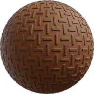</a> <b><a href="metal_grate_rusty">Metal Grate Rusty</a></b> by Dimitrios Savva, Rob Tuytel · <a href="https://polyhaven.com/a/metal_grate_rusty">source</a> | <a href="metal_plate">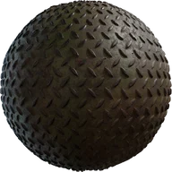</a> <b><a href="metal_plate">Metal Plate</a></b> by Rob Tuytel · <a href="https://polyhaven.com/a/metal_plate">source</a> | <a href="metal_plate_02">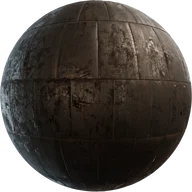</a> <b><a href="metal_plate_02">Metal Plate 02</a></b> by Rob Tuytel · <a href="https://polyhaven.com/a/metal_plate_02">source</a> | <a href="painted_metal_shutter">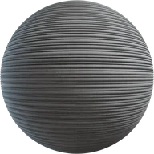</a> <b><a href="painted_metal_shutter">Painted Metal Shutter</a></b> by Charlotte Baglioni, Dario Barresi, Rico Cilliers · <a href="https://polyhaven.com/a/painted_metal_shutter">source</a> |
| <a href="rust_coarse_01">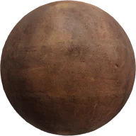</a> <b><a href="rust_coarse_01">Rust Coarse 01</a></b> by Dimitrios Savva, Rico Cilliers · <a href="https://polyhaven.com/a/rust_coarse_01">source</a> | <a href="rusted_shutter">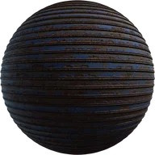</a> <b><a href="rusted_shutter">Rusted Shutter</a></b> by Dimitrios Savva · <a href="https://polyhaven.com/a/rusted_shutter">source</a> | <a href="rusty_corrugated_iron">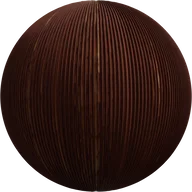</a> <b><a href="rusty_corrugated_iron">Rusty Corrugated Iron</a></b> by Charlotte Baglioni · <a href="https://polyhaven.com/a/rusty_corrugated_iron">source</a> | <a href="rusty_metal">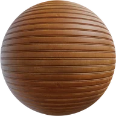</a> <b><a href="rusty_metal">Rusty Metal</a></b> by Rob Tuytel · <a href="https://polyhaven.com/a/rusty_metal">source</a> |
| <a href="rusty_metal_02">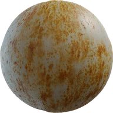</a> <b><a href="rusty_metal_02">Rusty Metal 02</a></b> by Rob Tuytel · <a href="https://polyhaven.com/a/rusty_metal_02">source</a> | <a href="rusty_metal_03">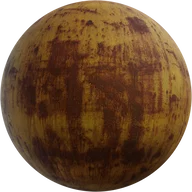</a> <b><a href="rusty_metal_03">Rusty Metal 03</a></b> by Amal Kumar · <a href="https://polyhaven.com/a/rusty_metal_03">source</a> | <a href="rusty_metal_04">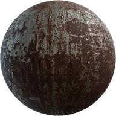</a> <b><a href="rusty_metal_04">Rusty Metal 04</a></b> by Amal Kumar · <a href="https://polyhaven.com/a/rusty_metal_04">source</a> | <a href="rusty_metal_05">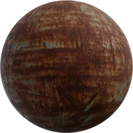</a> <b><a href="rusty_metal_05">Rusty Metal 05</a></b> by Amal Kumar · <a href="https://polyhaven.com/a/rusty_metal_05">source</a> |
| <a href="rusty_metal_grid">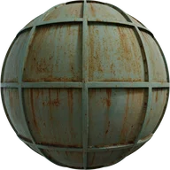</a> <b><a href="rusty_metal_grid">Rusty Metal Grid</a></b> by Amal Kumar · <a href="https://polyhaven.com/a/rusty_metal_grid">source</a> | <a href="rusty_metal_sheet">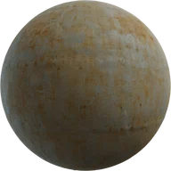</a> <b><a href="rusty_metal_sheet">Rusty Metal Sheet</a></b> by Amal Kumar · <a href="https://polyhaven.com/a/rusty_metal_sheet">source</a> | <a href="rusty_metal_shutter">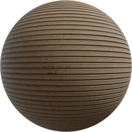</a> <b><a href="rusty_metal_shutter">Rusty Metal Shutter</a></b> by Charlotte Baglioni · <a href="https://polyhaven.com/a/rusty_metal_shutter">source</a> | <a href="rusty_painted_metal">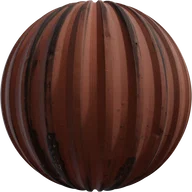</a> <b><a href="rusty_painted_metal">Rusty Painted Metal</a></b> by Amal Kumar · <a href="https://polyhaven.com/a/rusty_painted_metal">source</a> |
| <a href="worn_corrugated_iron">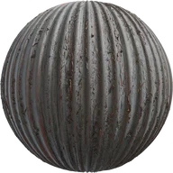</a> <b><a href="worn_corrugated_iron">Worn Corrugated Iron</a></b> by Dimitrios Savva, Jenelle van Heerden · <a href="https://polyhaven.com/a/worn_corrugated_iron">source</a> | <a href="worn_shutter">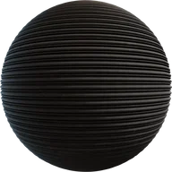</a> <b><a href="worn_shutter">Worn Shutter</a></b> by Dimitrios Savva · <a href="https://polyhaven.com/a/worn_shutter">source</a> |  |  |

---

Kept up to date by this repository's own [update workflow](.github/workflows/update.yml), with code and plan from [cc0-mirror](https://github.com/zuujis-cc0/cc0-mirror). Something wrong? [Open an issue there](https://github.com/zuujis-cc0/cc0-mirror/issues/new) or use the [private report form](https://games.zuujis.com/report).
